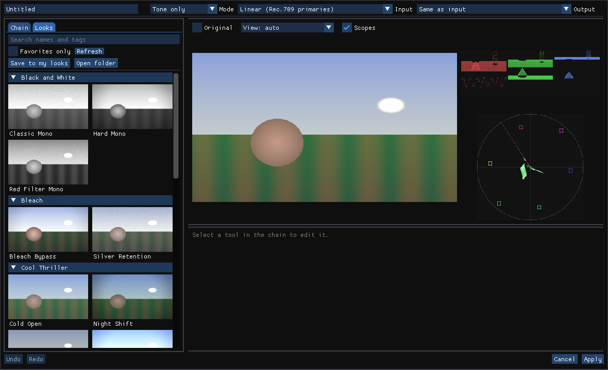

# Dyeline user guide

Dyeline is an OFX plugin that applies a *look* to your footage: a chain of photographic tools
(exposure, curves, color grades, lens and film effects) that runs on the GPU in your host. You
build looks in the **Look Designer**, a window that opens from the plugin, and save the ones you
like as `.dyeline` files to reuse and share.

This guide covers version 0.1. For what each tool does, see [tools.md](tools.md); for the color
settings in detail, [color.md](color.md).

- [Installing](#installing)
- [Your first look](#your-first-look)
- [Color settings](#color-settings)
- [The Look Designer](#the-look-designer)
- [Look files](#look-files)
- [Host notes](#host-notes)
- [Troubleshooting](#troubleshooting)

## Installing

Download the package for your system from the project's GitHub releases and follow
[INSTALL.md](../packaging/INSTALL.md): a setup program on Windows, a `.pkg` on macOS, and
`install.sh` on Linux. Restart your host afterwards. Dyeline shows up in the effects list as
**Dyeline**.

## Your first look

1. Add **Dyeline** to a clip or node, like any other effect.
2. Set its color settings if your host doesn't work in scene-linear (see
   [Color settings](#color-settings)). In Natron and Nuke the defaults are right.
3. Click **Edit Look...** in the effect's controls. The Look Designer opens with the current
   frame in its preview. Your host waits while the designer is open.
4. Pick a starting point on the **Looks** tab, or build from scratch on the **Chain** tab with
   **Add tool**.
5. Adjust the tools until the preview looks right, then click **Apply**. The designer closes,
   and the host renders the clip with the look. **Cancel** closes it and leaves the clip as it
   was.

The look is saved with your project, in the effect itself, so copying the effect or the clip
copies the look too. The **Designer** line under the button says what happened the last time
it was opened.

**Strength** in the effect's controls blends the whole look with the untouched image, from 0
(no look) to 1 (all of it). It can be animated, so a look can fade in.

## Color settings

The tools always work on scene-linear light, so Dyeline needs to know what your host hands it.
The three settings are along the top of the Look Designer:

- **Input**: the color space of the images the host gives Dyeline.
- **Output**: the space to give back. *Same as input* is usual, so the clip leaves Dyeline the
  way it came in.
- **Mode**: *Tone only* converts just the brightness curve and keeps the footage's own color
  primaries; *Full* also converts the gamut, so the tools see true ACEScg.

Some starting points:

| Your setup | Input | Mode |
| --- | --- | --- |
| Natron, Nuke, or any host working in scene-linear | Linear (the default) | Tone only |
| A Rec.709 (video) timeline | Rec.709 | Tone only |
| Log footage on a log timeline, such as ARRI LogC3 | That camera's space | Full |
| DaVinci Resolve with DaVinci Wide Gamut / Intermediate | DaVinci Intermediate | Full |

If the picture turns very dark, very flat or very contrasty as soon as you add Dyeline, even
with an empty look, the input space is wrong for your footage.

## The Look Designer



### Chain and Looks (left)

**Chain** lists the look's tools in the order they run, each working on the result of the one
above it. The checkbox bypasses a tool without losing its settings. Drag a tool to move it, or
right-click it to move it, duplicate it or remove it. **Add tool** adds a tool after the one
selected.

**Looks** shows the looks that come with Dyeline, grouped by mood, and your own, each as a
small picture of your frame with that look.

- Click a look to use it. It replaces the chain and the name, but keeps your color settings,
  since those describe your footage. **Undo** brings back what you had.
- Type in the search box to filter by name, tag or group.
- Right-click a look to add it to your favorites; **Favorites only** shows just those.
- **Save to my looks** keeps the look you're editing in your own library, under its name.
  **Open folder** shows that folder; subfolders you make there appear as groups.

### Preview and scopes (top right)

The preview shows the frame with the look. While you drag a slider it updates at a smaller
size so it can keep up, and sharpens when you let go. **Original** (or the **B** key) shows the
frame without the look, for comparing.

**View** decides how the preview is shown on your screen. *Auto* shows linear spaces through
the sRGB curve and video or log spaces as they are, which is right almost always.

Tools that work on part of the frame (Gradient Tint, Grad Exposure, Spot Exposure, Spot Fill,
Lens Vignette) and the lens tools with a center (Lens Distortion, Chromatic Aberration) draw
**handles** over the preview while selected. Drag the dot in the middle to
move the tool's center. A spot also has a circle, with a dot on it to drag its size; a gradient
has an arrow pointing to the side it changes, with a dot at its tip to turn it. Each drag is
one undo step, and the sliders follow along.

The scopes beside the preview (toggle them with **Scopes** or the **S** key) read the preview
as shown:

- The **RGB parade** shows the red, green and blue levels across the frame, side by side, from
  black at the bottom to white at the top. Use it to balance the channels and to see clipping.
- The **vectorscope** shows the colors: the further from the center, the more saturated, and
  the angle is the hue. The small boxes mark the primary and secondary colors, and the line
  from the center towards the upper left is where skin tones fall.

### Tool controls (bottom right)

The selected tool's **Strength** and parameters. Drag a slider, or Ctrl+click it (Cmd on macOS)
to type a value. Double-click a control, or right-click it, to put it back to its default.
Tools with many controls split them into tabs: the 3-Way Grade has **Wheels**, **HSL** (hue,
saturation and lightness for six color bands) and **Sat EQ** (saturation by brightness).

### Bottom bar

**Undo** and **Redo** (Ctrl+Z and Ctrl+Shift+Z, or Cmd on macOS) step through every change,
including applying a look from the browser. **Export .cube** saves the look as a 3D LUT (see
below). **Apply** and **Cancel** end the session; when the designer edits a look file instead,
they are **Save** (Ctrl+S) and **Close**.

### Exporting a LUT

**Export .cube** bakes the look into a 3D LUT that other software, monitors and cameras can
load. Choose 33 points unless the other side asks otherwise. The LUT takes images in the
look's input space and gives the output space, so for footage with bright highlights set the
input to the camera's log space first: a LUT from a linear input cuts off everything brighter
than white.

A LUT can only map one color to another, so tools that depend on where a pixel is or on its
neighbors are left out: the gradient and spot tools, **Lens Vignette**, **Lens Distortion**,
**Chromatic Aberration**, **Grain**, **Diffusion Filter**, **Local Contrast**, **Telecine Net**
and **Halation**.
The export dialog lists what will be left out, and the file's header names it.

## Look files

A `.dyeline` file is one look, as a small text (JSON) file. Saving to your looks writes one,
and you can copy them between machines, share them, or keep them in a project folder. Your
own looks live in:

| System | Folder |
| --- | --- |
| Windows | `%APPDATA%\Dyeline\looks` |
| macOS | `~/Library/Application Support/Dyeline/looks` |
| Linux | `~/.local/share/dyeline/looks` |

Uninstalling or updating Dyeline keeps them.

### Linking a clip to a look file

The effect's **Look File** field can point at a `.dyeline` file. While it is set, the clip
renders that file instead of the look saved in the project, and picks up changes whenever the
file is saved, so several clips can share one look and change together. **Edit Look...** then
edits the file. Clear the field to go back to the project's own look.

Some hosts only render again when a value changes. If the clip still shows the old look after
you saved the file, add one to **Reload Look File**. In EffectCraft the designer can do that
for you (see [EffectCraft](#effectcraft)).

### Open Designer

**Open Designer** opens the designer on the **Look File** without the host waiting for it: add
one to it (type the next number, or drag the slider). Your host keeps running while you edit,
and each **Save** in the designer updates the clip. Use it in hosts that don't show the **Edit
Look...** button, such as EffectCraft, or when you'd rather keep the designer open beside the
host. Set **Look File** first; the file is created if it doesn't exist.

### Opening the designer on its own

The designer is a program inside the plugin bundle, and you can start it yourself to work on a
look file without a host:

```sh
# Linux
/usr/OFX/Plugins/Dyeline.ofx.bundle/Contents/Linux-x86-64/dyeline-designer --file ~/looks/night.dyeline
# macOS
/Library/OFX/Plugins/Dyeline.ofx.bundle/Contents/MacOS/dyeline-designer --file ~/looks/night.dyeline
# Windows
"C:\Program Files\Common Files\OFX\Plugins\Dyeline.ofx.bundle\Contents\Win64\dyeline-designer.exe" --file night.dyeline
```

The file is created if it doesn't exist. Opened this way there is no frame to preview, and the
looks browser shows its thumbnails on a built-in test image instead.

The installers on Windows and Linux also add **Dyeline Look Designer** to the Start menu or
your desktop's application menu. Started from there, it opens a new look, saved as
`Untitled.dyeline` (then `Untitled 2.dyeline` and so on) in your own looks folder.

## Host notes

- **DaVinci Resolve**: add Dyeline from the OpenFX library onto a node. Set the color settings
  to match your project's timeline color space (see [Color settings](#color-settings)).
- **Natron**: the defaults suit Natron, which works in scene-linear. Edit Look opens the
  designer with the frame at the playhead.
- **EffectCraft**: see below.

### EffectCraft

EffectCraft doesn't show push buttons, so **Edit Look...** isn't there. Use a look file:

1. Set **Look File** to a `.dyeline` file, such as `~/looks/night.dyeline`.
2. Add one to **Open Designer**. The designer opens on the file with the current frame.
3. Edit, and click **Save** whenever you want to see the result in EffectCraft.

EffectCraft only renders an effect again when one of its values changes. If you start
EffectCraft with its control channel on (`effectcraft --control 9877`, or with
`EFFECTCRAFT_CONTROL_PORT=9877` set), each Save adds one to **Reload Look File** on every
Dyeline effect that uses the file, so the viewer updates by itself. The designer's status line
says whether that worked. Without the channel, add one to **Reload Look File** yourself after
saving. The channel accepts commands from any program on your computer, so only turn it on
while you use it.

EffectCraft renders effects on the CPU. Dyeline renders on your GPU anyway when **Use
Dyeline's GPU** is on (see [Rendering is slow](#troubleshooting)).

## Troubleshooting

**"Dyeline: part of this look is bypassed"**: a tool couldn't run, most often a LUT tool whose
`.cube` file has moved. The message names it. The rest of the look still renders.

**"this look uses tools this version doesn't have"**: the look was made with a newer Dyeline.
Those tools are skipped but kept in the look, so nothing is lost when you update.

**Nothing happens when I click Edit Look**: some hosts don't let effects open windows. Use a
[look file](#linking-a-clip-to-a-look-file) and [Open Designer](#open-designer) instead. The
**Designer** line under the button shows any error.

**The designer opened without a preview**: the host didn't hand out the frame (an unconnected
input, or a host that only gives images while rendering). Editing works as usual.

**Rendering is slow**: Dyeline renders on the GPU your host hands it: CUDA on NVIDIA GPUs,
Metal on Macs and OpenCL elsewhere. When the host renders on the CPU (EffectCraft, and Natron
without OpenCL), **Use Dyeline's GPU** renders on the computer's GPU anyway, through Metal on
a Mac and OpenCL elsewhere, and copies the frame there and back. Without a GPU it falls back to
the CPU. On Linux, install your GPU's OpenCL driver: for AMD and Intel, `mesa-opencl-icd`. With
Mesa's newer Rusticl driver, also set `RUSTICL_ENABLE=radeonsi` (AMD) or `RUSTICL_ENABLE=iris`
(Intel) before starting the host. If a GPU fails, Dyeline prints why to the host's terminal
and renders the rest of the session on the CPU. The tools that blur (Diffusion Filter, Local Contrast, Telecine Net, Halation)
cost the most; bypass them while you work.

**macOS won't open the installer**: it isn't signed yet. Right-click the `.pkg`, choose
**Open**, and confirm.
